  

  

  
  
  

  一个喜欢折腾新工具、慢慢学习开源的普通开发者。 
  Just someone who enjoys tinkering with new tools and learning open source, one small project at a time.

---

<h3 align="center">🌱 最近在探索 / Currently exploring</h3>

  🤖 AI 工具与编程助手 AI tools &amp; coding assistants &nbsp;·&nbsp;
  🌍 优秀开源项目 great open-source projects &nbsp;·&nbsp;
  🛠️ 解决日常小问题的小脚本 small everyday scripts

<h3 align="center">🧰 工具箱 / Toolbox</h3>

  

<h3 align="center">🚀 项目 / Projects</h3>

  
  

  把 GitHub Trending 整理成 Markdown / JSON 的零依赖 Python 小工具 · 精选收藏见 <a href="awesome-picks.md">awesome-picks.md</a> 
  A dependency-free Python CLI for GitHub Trending · Curated picks in <a href="awesome-picks.md">awesome-picks.md</a> 
  📚 <a href="https://github.com/imissshe/daily-learning">daily-learning</a>：每天一道算法题或一篇学习笔记 · One algorithm problem or one study note per day

---

<h3 align="center">🔥 今日 GitHub 热门 / Today's Trending</h3>

<!-- TRENDING:START -->

| # | 项目 Repository | 简介 Description | 语言 Lang | ⭐ 今日 Today |
|:-:|:--|:--|:-:|--:|
| 1 | [dream-num/univer](https://github.com/dream-num/univer) | Build your own AI office with Univer Office SDK. Bring editing, calculation, collaboratio… | TypeScript | +988 |
| 2 | [ag-ui-protocol/ag-ui](https://github.com/ag-ui-protocol/ag-ui) | AG-UI: the Agent-User Interaction Protocol. Bring Agents into Frontend Applications. | TypeScript | +355 |
| 3 | [google-labs-code/stitch-skills](https://github.com/google-labs-code/stitch-skills) | A library of Agent Skills designed to work with the Stitch MCP server. Each skill follows… | TypeScript | +247 |
| 4 | [backnotprop/plannotator](https://github.com/backnotprop/plannotator) | The workspace to stay in the loop and on top of agents - shape, decide, plan, annotate, r… | TypeScript | +866 |
| 5 | [ChromeDevTools/chrome-devtools-mcp](https://github.com/ChromeDevTools/chrome-devtools-mcp) | Chrome DevTools for coding agents | TypeScript | +717 |
| 6 | [alibaba/open-code-review](https://github.com/alibaba/open-code-review) | Secure, fast, efficient, battle-tested at Alibaba's scale. Hybrid architecture code revie… | Go | +691 |
| 7 | [Tencent/LoopForge](https://github.com/Tencent/LoopForge) | Self-hosted workflows for coding-agent delivery. Orchestrate CodeBuddy, Codex and Claude … | Go | +423 |
| 8 | [ggml-org/ggml](https://github.com/ggml-org/ggml) | Tensor library for machine learning | C++ | +43 |
| 9 | [elementalsouls/Claude-BugHunter](https://github.com/elementalsouls/Claude-BugHunter) | A Claude Code skill bundle for bug hunting and external red-team work - 82 skills, 15 sla… | Python | +98 |
| 10 | [GoogleChrome/modern-web-guidance-src](https://github.com/GoogleChrome/modern-web-guidance-src) | Keep your coding agent up to date with the latest web best practices | TypeScript | +1,219 |

🕒 更新于 Updated: 2026-11-16 15:46 (UTC+8) · 数据来源 Source: [github.com/trending](https://github.com/trending) · 由 [gh-trending-digest](https://github.com/imissshe/gh-trending-digest) 自动生成

<!-- TRENDING:END -->

---

<h3 align="center">📊 GitHub Stats</h3>

  
  

  

<h3 align="center">🏆 Trophies</h3>

  

<h3 align="center">🐍 Contribution Snake</h3>

  <picture>
    <source media="(prefers-color-scheme: dark)" srcset="https://raw.githubusercontent.com/imissshe/imissshe/output/github-snake-dark.svg" />
    <source media="(prefers-color-scheme: light)" srcset="https://raw.githubusercontent.com/imissshe/imissshe/output/github-snake.svg" />
    
  </picture>

慢慢来，比较快。 Slow is smooth, smooth is fast.

  

