  

  

  
  
  

  一个喜欢折腾新工具、慢慢学习开源的普通开发者。 
  Just someone who enjoys tinkering with new tools and learning open source, one small project at a time.

---

<h3 align="center">🌱 最近在探索 / Currently exploring</h3>

  🤖 AI 工具与编程助手 AI tools &amp; coding assistants &nbsp;·&nbsp;
  🌍 优秀开源项目 great open-source projects &nbsp;·&nbsp;
  🛠️ 解决日常小问题的小脚本 small everyday scripts

<h3 align="center">🧰 工具箱 / Toolbox</h3>

  

<h3 align="center">🚀 项目 / Projects</h3>

  
  

  把 GitHub Trending 整理成 Markdown / JSON 的零依赖 Python 小工具 · 精选收藏见 <a href="awesome-picks.md">awesome-picks.md</a> 
  A dependency-free Python CLI for GitHub Trending · Curated picks in <a href="awesome-picks.md">awesome-picks.md</a> 
  📚 <a href="https://github.com/imissshe/daily-learning">daily-learning</a>：每天一道算法题或一篇学习笔记 · One algorithm problem or one study note per day

---

<h3 align="center">🔥 今日 GitHub 热门 / Today's Trending</h3>

<!-- TRENDING:START -->

| # | 项目 Repository | 简介 Description | 语言 Lang | ⭐ 今日 Today |
|:-:|:--|:--|:-:|--:|
| 1 | [JetBrains/thinkrail](https://github.com/JetBrains/thinkrail) | Vibe code with pi in a lightweight, real IDE that customises itself around the way you wo… | TypeScript | +1,068 |
| 2 | [elayadesign/ai-design-skills](https://github.com/elayadesign/ai-design-skills) | - | - | +2,139 |
| 3 | [obra/superpowers](https://github.com/obra/superpowers) | An agentic skills framework & software development methodology that works. | Shell | +1,095 |
| 4 | [HKUDS/DeepTutor](https://github.com/HKUDS/DeepTutor) | DeepTutor: Lifelong Personalized Tutoring. https://deeptutor.info/. | Python | +2,371 |
| 5 | [macro-inc/macro](https://github.com/macro-inc/macro) | Macro is a unified workspace for teams: email, chat, docs, tasks, agents, calls, and CRM … | Rust | +117 |
| 6 | [Nutlope/hallmark](https://github.com/Nutlope/hallmark) | Anti-AI-slop design skill for Claude Code, Cursor, and Codex. | CSS | +2,110 |
| 7 | [pbakaus/impeccable](https://github.com/pbakaus/impeccable) | The design vocabulary for your coding agent. Steer with polish and bolder, review with cr… | Rust | +1,472 |
| 8 | [makecindy/cindy](https://github.com/makecindy/cindy) | Consider it done. The open-source AI agent that works out of the box · 想到，就能做到。开源、开箱即用的 A… | TypeScript | +728 |
| 9 | [nightly-labs/openbot](https://github.com/nightly-labs/openbot) | A local-first desktop workspace for persistent AI teammates. Run Codex, Claude, and Grok … | TypeScript | +1,054 |
| 10 | [hmjz100/LinkSwift](https://github.com/hmjz100/LinkSwift) | 一个基于 JavaScript 的网盘文件下载地址获取工具。基于【网盘直链下载助手】修改 ，支持 百度网盘 / 阿里云盘 / 中国移动云盘 / 天翼云盘 / 迅雷云盘 / 夸克网… | JavaScript | +1,616 |

🕒 更新于 Updated: 2026-10-29 12:25 (UTC+8) · 数据来源 Source: [github.com/trending](https://github.com/trending) · 由 [gh-trending-digest](https://github.com/imissshe/gh-trending-digest) 自动生成

<!-- TRENDING:END -->

---

<h3 align="center">📊 GitHub Stats</h3>

  
  

  

<h3 align="center">🏆 Trophies</h3>

  

<h3 align="center">🐍 Contribution Snake</h3>

  <picture>
    <source media="(prefers-color-scheme: dark)" srcset="https://raw.githubusercontent.com/imissshe/imissshe/output/github-snake-dark.svg" />
    <source media="(prefers-color-scheme: light)" srcset="https://raw.githubusercontent.com/imissshe/imissshe/output/github-snake.svg" />
    
  </picture>

慢慢来，比较快。 Slow is smooth, smooth is fast.

  

